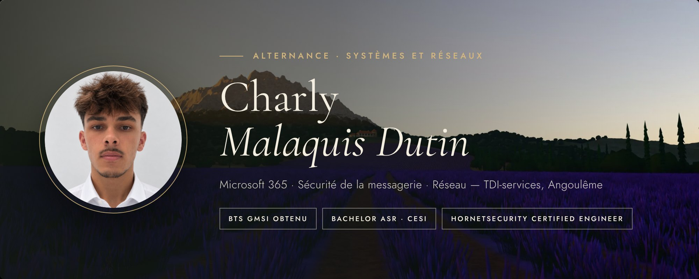
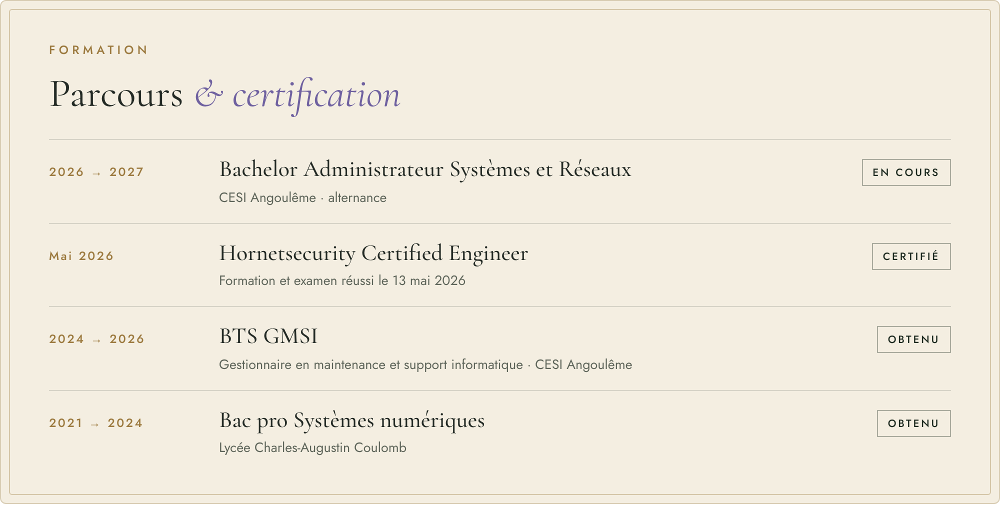
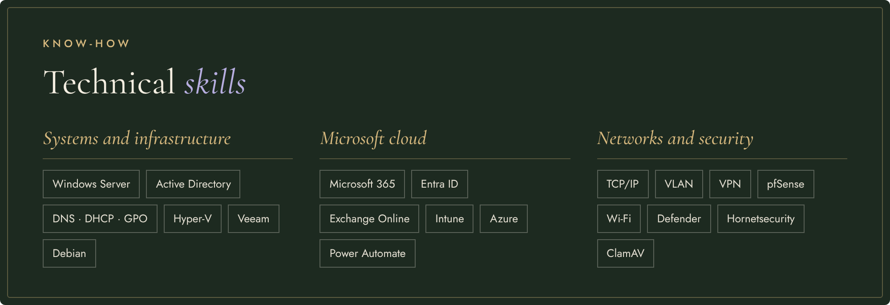

  

&nbsp;
&nbsp;
&nbsp;

  

*Alternant en administration systèmes et réseaux chez **TDI-services**, orienté **Microsoft 365**, **sécurité de la messagerie** et **réseau**.* 
*Certifié **Hornetsecurity Certified Engineer** · CESI Angoulême · Angoulême / Poitiers*

## Expérience

### TDI-services · Alternance
SEPTEMBRE 2024 → AUJOURD'HUI · BU 365, PUIS BU 365 ET BU IT EN 3E ANNÉE

> **Microsoft 365**
> Administration et sécurisation de tenants clients : Entra ID, MFA et Passkey, accès conditionnel, Exchange Online (DKIM, DMARC), Teams, SharePoint, rétention.

> **Hornetsecurity**
> Intégration récurrente de tenants clients sur 365 Total Protection, **plus de 200 à ce jour**. Configuration de 365 Tenant Manager, 365 Total Backup et de la sécurité des e-mails. Rédaction des procédures de l'équipe.

> **BU IT · Réseaux et infrastructure**
> Projet client : relevé de l'existant, plan d'adressage IP et VLAN, préconfiguration des switches et du Wi-Fi, bascule sur site avec retour arrière, recette et documentation.

**Stages** · Charente Informatique Diffusion (2023 → 2024 : sauvegarde Datto BCDR, dépannage, réseau) · Leroy-Somer (2023 : helpdesk, installation de serveur, machines virtuelles)

<b>English version</b>

 

*Systems and network administration apprentice at **TDI-services**, focused on **Microsoft 365**, **email security** and **networking**. **Hornetsecurity Certified Engineer** · CESI Angoulême.*

### Experience

**TDI-services · Apprenticeship** (September 2024 → present · BU 365, then BU 365 and IT BU in the 3rd year)

- **Microsoft 365**: administration and hardening of customer tenants (Entra ID, MFA and Passkey, conditional access, Exchange Online DKIM / DMARC, Teams, SharePoint, retention).
- **Hornetsecurity**: recurring onboarding of customer tenants onto 365 Total Protection, over 200 so far; 365 Tenant Manager, 365 Total Backup and email security setup; team procedures.
- **IT BU · Networks and infrastructure**: customer project from site survey, IP and VLAN plan, switch and Wi-Fi pre-configuration to on-site cutover with rollback, acceptance and documentation.

**Internships**: Charente Informatique Diffusion (Datto BCDR backup, repair, networking) · Leroy-Somer (helpdesk, server installation, virtual machines).

<a href="https://charly-it.github.io/CV-Charly-Malaquis-Dutin-EN.pdf">Download my CV in English (PDF)</a>

