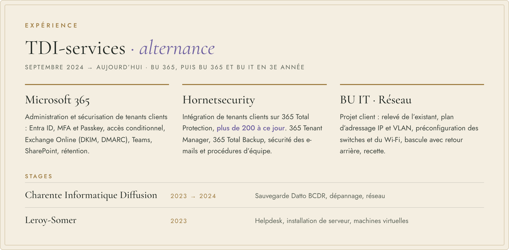
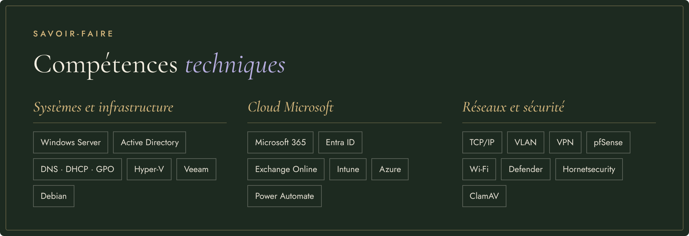
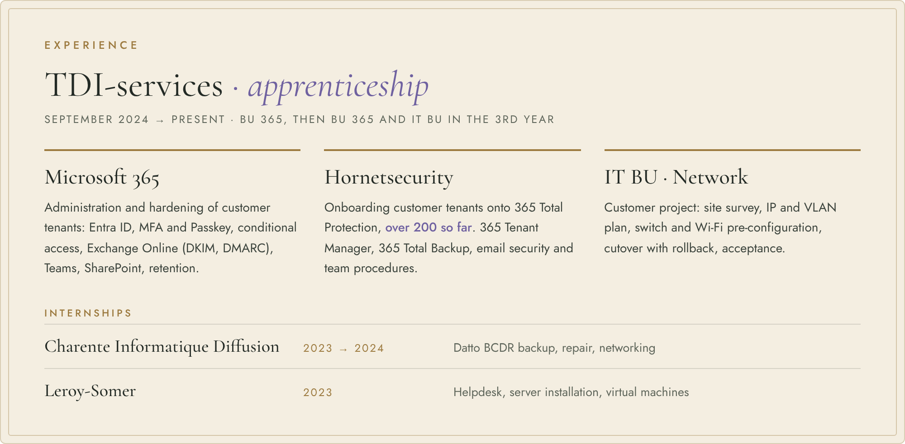
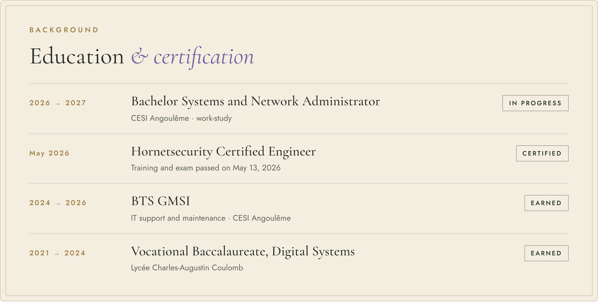

  

&nbsp;
&nbsp;
&nbsp;

  

*Alternant en administration systèmes et réseaux chez **TDI-services**, orienté **Microsoft 365**, **sécurité de la messagerie** et **réseau**.* 
*Certifié **Hornetsecurity Certified Engineer** · CESI Angoulême · Angoulême / Poitiers*

<b>English version</b>

 

*Systems and network administration apprentice at **TDI-services**, focused on **Microsoft 365**, **email security** and **networking**. **Hornetsecurity Certified Engineer** · CESI Angoulême.*

<a href="https://charly-it.github.io/CV-Charly-Malaquis-Dutin-EN.pdf">Download my CV in English (PDF)</a>

